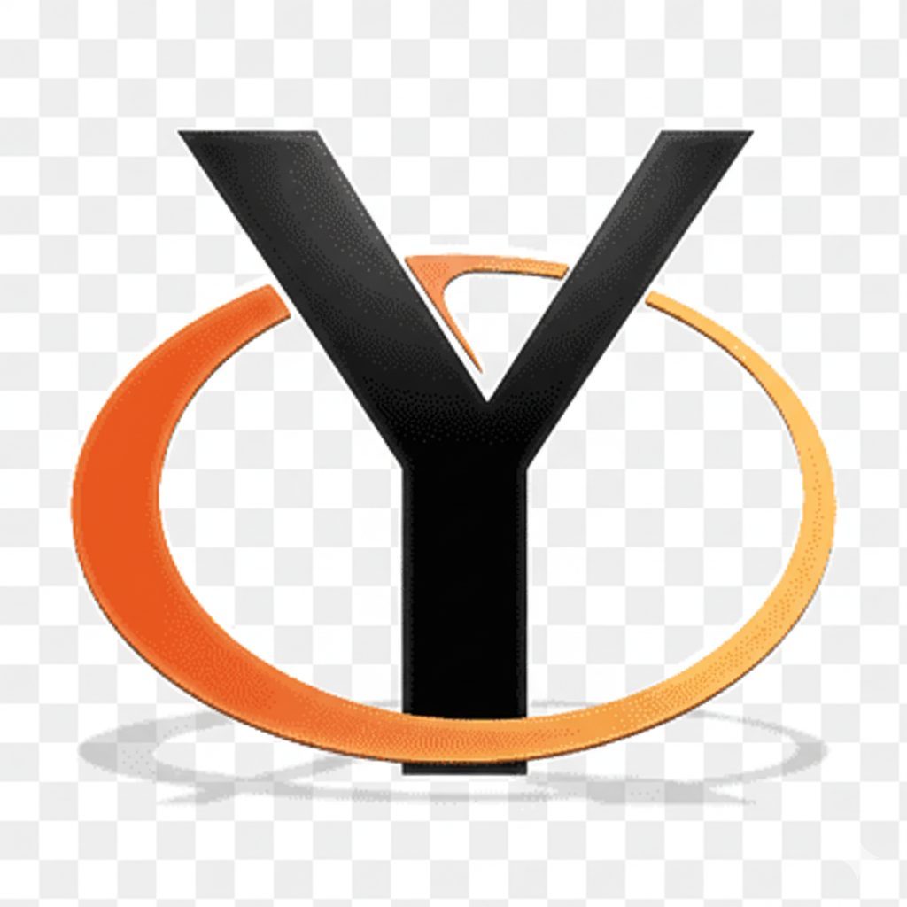
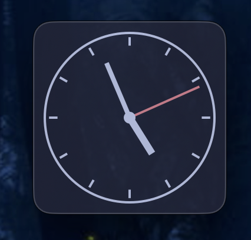
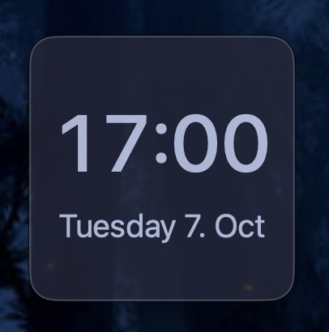

# yclock



A simple analog clock application for macOS, inspired by
[xclock](https://www.x.org/releases/X11R7.6/doc/man/man1/xclock.1.xhtml)
from X11 that you're used to on Linux and the BSDs.

## Features

- Analog and digital clock modes (toggle with ⌘D)
- Optional seconds display (toggle with ⌘S)
- Real-time updates every second
- Clean, minimal interface with no window chrome
- Draggable anywhere on the clock face
- Translucent window that floats above other windows and is visible on all desktops
- Themeable via configuration file
- Command line options for startup mode

## Screenshots




## Usage

```bash
yclock [OPTIONS]

Options:
  --digital         Start in digital mode
  --analog          Start in analog mode (default)
  --analogue        Same as --analog
  --seconds         Show seconds hand/display
  --show-in-dock    Show app in Dock and Cmd+Tab switcher
  --font-name NAME  Specify font name for digital clock
  --new-instance    Start a new instance even if one is already running
  --help            Show this help message

Examples:
  yclock --digital --seconds
  yclock --analog
  yclock --digital --font-name Menlo
  yclock --font-name "Courier New" --seconds
  yclock --show-in-dock
```

Only one instance runs at a time: launching yclock again activates the running one and exits, ignoring any other options. Use `--new-instance` to start another.

## Keyboard shortcuts

These work when the clock window is focused:

- ⌘D: toggle digital/analog
- ⌘S: toggle seconds
- ⌘F: toggle maximised
- ⌘Q: quit

## Configuration

`yclock` can be themed by creating a configuration file. The app looks
for config files in the following order:
1. `~/.yclock.conf`
2. `~/.config/yclock/yclock.conf`
3. `$XDG_CONFIG_HOME/yclock/yclock.conf`

See [conf/yclock.conf](conf/yclock.conf) for the full sample config with every
option explained. The default theme is Catppuccin Macchiato.

Short example:
```perl
# Colors in #RRGGBB or #RRGGBBAA hex format (AA = alpha, 00 hides the element)
background = #24273af2
foreground = #cad3f5
second_hand = #ed8796

# Clock mode (analog or digital)
mode = analog

# Window size in base units; on-screen size = value * scale
width = 100
height = 100

# Font name for digital clock (optional)
# Examples: Menlo, Monaco, Courier, Helvetica, Arial
font = Menlo

# Show app in Dock and Cmd+Tab switcher (default: false)
# When false, app runs as an accessory and doesn't appear in Dock or Cmd+Tab
# show_in_dock = false
```

## Requirements

- macOS 11.0 or later
- Xcode Command Line Tools (for swiftc compiler)

## Building

```bash
$ make clean && make build
```

## Running

```bash
$ make run
```

## Testing

```bash
$ make test
```

## Installing

Install the application and man page to /Applications:
```bash
$ make install
```

This will install both the application bundle and the man page. After
installation, you can view the manual with:

```bash
$ man yclock
```
and start the application with:

```bash
$ yclock
```

## License

This project is licensed under the Apache License 2.0 - see the
[LICENSE](LICENSE) file for details.
